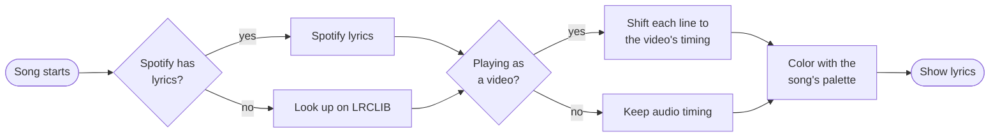

<div align="center">

# 🎤 Spotify Lyrics Mod

**Music videos and synced lyrics, side by side in Spotify.**


https://github.com/user-attachments/assets/c349757c-69ad-4436-b8e0-89439a88d22b

</div>

---

## ✨ Features

| | Feature | What you get |
|:-:|---|---|
| 🎬 | **Video and lyrics together** | The video plays in the middle, with lyrics in a new sidebar tab. |
| ⏱️ | **Always in sync** | Videos add intros and cut verses. The lyrics shift to match. |
| 👆 | **Jump to any line** | Click a lyric to skip straight to it. |
| 📚 | **Lyrics Spotify doesn't have** | Missing lyrics come from [LRCLIB](https://lrclib.net), a free lyrics library. |
| 🎨 | **Spotify's colors** | Every song's lyrics use the colors Spotify's own lyrics page picks for it. |

---

## 🖼️ How it looks

```text
┌──────────────────────────────────────────┬─────────────────────────┐
│                                          │  Lyrics   Queue  Recent │
│                                          │  ─────                  │
│                                          │  Woke up, the sun…      │  ◀ current line
│             🎬  music video              │  Warm beach from palm…  │
│                                          │  You close your eyes…   │
│                                          │                         │
└──────────────────────────────────────────┴─────────────────────────┘
```

> 💡 The mod rearranges things only after 30 seconds without input, or when Spotify isn't the front window. It never moves things while you're browsing.

---

## 🔀 How lyrics are picked



---

## 🚀 Install

> Requires [Spicetify](https://spicetify.app). First time patching Spotify? Run `spicetify backup apply` once.

```bash
node build.mjs && cp dist/videoLyrics.js ~/.config/spicetify/Extensions/ \
  && spicetify config extensions videoLyrics.js && spicetify apply
```

<details>
<summary><b>Spotify updated and the mod disappeared?</b></summary>

Spotify replaces the patched app when it updates. Patch it again from the macOS **Terminal** app:

```bash
spicetify backup apply
```
</details>

<details>
<summary><b>Uninstall</b></summary>

```bash
spicetify config extensions videoLyrics.js- && spicetify apply
```

To go back to stock Spotify: `spicetify restore`.
</details>

---

## 🛠️ Develop

```bash
node build.mjs   # build dist/videoLyrics.js
node --test      # run the tests (no npm install needed)
```

---

<details>
<summary><b>⚠️ Known limits</b></summary>

- A Spotify UI update can break the Lyrics tab. The mod relies on Spotify's page layout.
- Only Spotify's own music videos play. YouTube isn't supported.
- For songs without Spotify lyrics, the mod sends the title, artist, album and length to lrclib.net. Nothing else.
- LRCLIB results more than 3 seconds off the song's length are skipped.
- Videos over 10 minutes show lyrics at the audio's timing.
- Where a video cuts part of the song, those lines all show at once.
</details>
